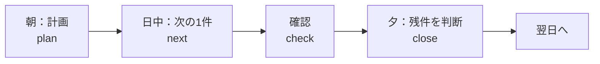

# dayloop

**「今日やること」「まだ終わっていないこと」「返答を待っている依頼」を、毎日確認するためのWindows向けツールです。**

PowerShellなどの端末で使います。朝は仕事を並べ、日中は次の1件を選び、夕方は残件を確認します。相手への依頼には「次にいつ確認するか」を登録し、その時刻になったら返答や変更の有無を確認できます。AIやOutlookを使わず、手入力から始められます。

## 何ができるか

| やりたいこと | できること |
|---|---|
| 今日の仕事を決める | 仕事と見積時間を登録し、今日の予定を確認して確定する |
| 次に何をするか選ぶ | 期限、持ち越し回数、見積時間をもとに、次の1件を表示する |
| 相手への依頼を追いかける | 相手・依頼内容・次回確認日時を登録し、確認する時刻まで保持する |
| 依頼の変更・取消を見落とさない | 届いた変更情報を提案として登録し、本人が適用・却下する。変更前後の履歴も残る |
| 終業前に残件を確認する | 1件ずつ「完了・未完了・持ち越し・取り下げ」を選ぶ。未回答がある日は終了を保留する |
| 週の仕事を振り返る | `retro`で完了率や持ち越しの多い仕事を確認する |

たとえば「取引先に見積を依頼し、明日の15時に回答を確認する」と登録すると、確認前は通常の待ち質問を出さず、確認時刻以降に問いかけます。返答が届いたら記録し、そこから自分が行う仕事を別に管理できます。**返答を記録しただけでは、自分の仕事は完了になりません。**

依頼の送信・催促・仕事の実行は本人が行います。dayloopが追跡するのは登録・取込した情報で、未登録の依頼まで自動で発見するものではありません。マウスで操作する専用GUIはなく、端末かMCP対応クライアントで使います。

[ダウンロードと必要なもの](#ダウンロードと必要なもの) · [すぐ試す](#すぐ試す) · [相手待ちの追跡](#相手待ちの追跡) · [詳しい資料](#詳しい資料)

## ダウンロードと必要なもの

**現在はソースコードの配布です。ZIPをダウンロードしただけでは起動できません。**

2026-10-15時点で、[GitHub Releases](https://github.com/awano27/dayloop/releases)に実行ファイルやインストーラーの配布はありません。`Code → Download ZIP`で取得できるのはソースコードです。Rust・CargoとWindows用ビルド環境を用意し、自分のPCで`dayloop.exe`を作る必要があります。手元の`target/`にある実行ファイルはソースZIPに含まれません。

また、トップページで選ばれている`master`には相手待ち・依頼変更の追跡が未統合です。このREADMEの約束追跡を試す場合は、[codex/requirements-gapブランチ](https://github.com/awano27/dayloop/tree/codex/requirements-gap)を選び、[そのブランチのソースZIP](https://github.com/awano27/dayloop/archive/refs/heads/codex/requirements-gap.zip)を取得してください。

| 使う機能 | 追加で必要なもの |
|---|---|
| ソースから実行ファイルを作る | Windows 10 / 11、Rust・Cargo（MSVC環境）、Visual StudioのC++ Build ToolsとWindows SDK。初回は依存取得用のネット接続 |
| 手入力の計画・次の仕事・残件確認・約束追跡 | ビルドした`dayloop.exe`とデータを保存できるフォルダ。AIの契約やAPIキーは不要 |
| AIクライアントから操作する | MCP対応クライアントとサーバー登録。dayloop側は`mcp`コマンドで起動 |
| Outlookのメール・予定を取り込む | 利用できるクラシックOutlookとアカウント |
| Outlook／Teamsの前面表示を読む | 対象アプリと別途用意する`wincli.exe`または`Sbroenne.WindowsMcp.exe` |
| Jevの判断支援を使う | TypeSafeへの接続設定・APIキー・ネット接続 |
| GitHubなどから仕事を取り込む | 各サービスのアカウント・認証情報。GitHubは`gh`のログイン情報も利用 |

2026-10-15にGitHubから両ブランチのソースZIPを取得し、ビルドして隔離データで確認しました。両方で日次操作が動き、開発ブランチでは約束登録・再起動後の保持・確認時刻前の質問抑制も確認できました。実行時は外部サービスの認証情報と外部コマンドを使わず、`dayloop.exe`だけを置いたフォルダから起動しました。

この確認はビルド環境があるWindows PCでの結果です。実機のOutlook／Teams、すべてのMCPクライアント、Rust未導入の新しいPCでの導入は未確認です。

## 1日の流れ



`plan`で必要な確認に答え、最後に計画を確定します。`next`で次の仕事を選び、`check`で未着手や期限到来の約束を確認します。`close`で残件を判断すると、日別のMarkdownを書き出します。前日の未確定タスクが残っていれば、先にその残りを確認します。

相手待ちの約束は日次タスクから独立しています。次回確認が未来なら、約束を毎日持ち越す必要はありません。予定に入れた関連タスクの残件判断は、別途必要です。

## すぐ試す

上の必要環境を用意し、ソースZIPを展開したフォルダ（`Cargo.toml`がある場所）で、新しいPowerShellを開いてください。ソースを置いたフォルダとデータ保存先に書き込めれば、dayloopの日次操作に管理者権限は不要です。ビルド環境のインストールにはPCの管理ポリシーが適用されます。

まずは専用の空フォルダで、手入力だけを試します。以下ではJev・Outlookの取込を無効にし、外部取込の認証情報と`gh`の自動利用も、このPowerShellの中だけで外します。

<details>
<summary>初回ビルドと、安全なサンプル操作を開く</summary>

```powershell
cargo build --locked
$dayloop = (Resolve-Path .\target\debug\dayloop.exe).Path

# サンプル用セッションだけの変更。保存済みの認証設定は変更しません。
foreach ($name in @('GITHUB_TOKEN', 'GH_TOKEN', 'JIRA_BASE_URL',
                    'TEAMS_TOKEN', 'GRAPH_TOKEN', 'AZURE_DEVOPS_ORG',
                    'DAYLOOP_JEV_API_KEY', 'TYPESAFE_API_KEY')) {
    [Environment]::SetEnvironmentVariable($name, $null, 'Process')
}
$env:PATH = ''

$env:DAYLOOP_HOME = Join-Path $env:TEMP ('dayloop-demo-' + [guid]::NewGuid())
New-Item -ItemType Directory -Path $env:DAYLOOP_HOME | Out-Null
@'
[jev]
mode = "off"
[intake]
outlook = false
'@ | Set-Content -Encoding utf8 (Join-Path $env:DAYLOOP_HOME 'config.toml')

& $dayloop where
& $dayloop add "仕様書をレビューする" --estimate 30
& $dayloop plan
& $dayloop next
& $dayloop check
& $dayloop close
& $dayloop today
```

</details>

質問には表示された選択肢で答えてください。サンプルの作業を終えたと想定する場合は、`close`で「完了」を選びます。未回答のまま終了した場合は、同じコマンドで続きから確認できます。

| コマンド | 画面で確認・操作する内容 |
|---|---|
| `add` | 仕事を登録する |
| `plan` | 今日の予定を見て「確定する」を選ぶ |
| `next` | 次に取り組む1件を見る |
| `check` | 未着手の仕事と、確認が必要な約束に答える |
| `close` | 残件の扱いを選び、その日を終了する |
| `today` | 今の予定・進行中・完了などを一覧で見る |

通常の保存先は`%LOCALAPPDATA%\dayloop`です。`DAYLOOP_HOME`を指定すると、設定・SQLite台帳・日誌をそのフォルダに保存します。サンプル用PowerShellを閉じれば、そのセッションの指定は終了します。サンプルデータはフォルダに残ります。

通常利用ではサンプル用PowerShellを閉じ、新しいPowerShellで`cargo build --locked --release`を実行し、`.\target\release\dayloop.exe`を使います。`config init`で設定を作り、`doctor`で利用できる機能を確認できます。Jevが利用できなくても手動の日次操作は成立します。

## 相手待ちの追跡

同じサンプル用PowerShellで、明日確認する約束を登録できます。JSONファイル経由なら、日本語や引用符も扱いやすくなります。

<details>
<summary>明日確認する依頼を登録する例を開く</summary>

```powershell
$requestFile = Join-Path $env:DAYLOOP_HOME 'request.json'
@{
    op_id = [guid]::NewGuid().ToString()
    request = '見積への回答を確認する'
    counterparty = 'サンプル取引先'
    next_check = [DateTimeOffset]::Now.AddDays(1).ToString('o')
    source = 'manual'
    evidence = 'サンプル：翌日に回答を確認する合意'
} | ConvertTo-Json | Set-Content -Encoding utf8 $requestFile

& $dayloop commitment register --file $requestFile
& $dayloop commitment list
```

</details>

約束には追跡ID・版番号・次回確認・判断履歴が付き、日次終了や再起動後も残ります。関連タスクを指定でき、相手待ちで進められない作業を`next`の対象から外すこともできます。

確認の延期、返答の記録、変更・取消・決着は、根拠と本人の明示操作で進めます。**返答が来ても、関連する自分の仕事は自動完了しません。** 件名だけで約束を照合せず、対応先が曖昧なら本人が選びます。

入力形式と回答手順は[相手待ち・依頼変更のガイド](docs/plans/commitment-tracking/GUIDE.md)を参照してください。

## 確認と終了のルール

- **確認時刻：** 今日と未来日は実時刻で判断し、確認日時と一致した時点で質問を出します。過去日はその日のJST末までに到来した確認を含めます。
- **計画確定：** 未回答の約束や変更提案があれば止まります。質問表示後に状態が変わった場合も、古い計画では確定できません。
- **閉じた日の再確認：** 後から確認事項が生じても、元の`closed_at`と日誌は維持します。「既に閉じた日」と「現在の未回答」を分けて表示します。
- **再実行：** 操作ID・元情報ID・版番号・日時で重複や古い更新を検査します。同じ操作の再試行には同じ操作IDを使います。

CLIの終了コードは`0`が正常終了、`1`がエラー、`2`が本人の回答待ちです。`close`は既に閉じた日でも未回答があれば`2`になります。`--yes`は非対話実行で、本人の回答を代わりに作る指定ではありません。

## MCPで使う

`dayloop.exe mcp`をstdioサーバーとして登録します。実行ファイルは絶対パスで指定してください。設定例は[MCP接続ガイド](docs/mcp-clients.md)にあります。

日次操作は`plan_day`、`check_in`、`close_day`です。`questions[]`の選択肢を本人に提示し、回答に対応するツールを呼びます。計画は必要な確認を処理して再表示し、最後の確定質問が持つ`plan_revision`を`confirm_plan`へ渡します。MCPもCLIと共通の台帳検査を通ります。

MCPの`closed`は閉じた事実を表します。その後の回答要否は`pending_count`と`questions`で確認してください。

## 取込と任意の判断支援

手入力に加え、Markdown、議事録、JSONのサンプルデータ、クラシックOutlookのメール・予定を取り込む入口があります。GitHub、Jira、Teams、Azure DevOpsの読取り処理もあり、認証情報が利用できると日次操作から自動取込を試みます。GitHubでは`gh`のログイン情報も使います。取得の失敗や部分取得を「依頼なし」の根拠にはしません。約束の変更分類・照合まで外部サービスから自動で完結することは、保証していません。

Outlook／Teamsの前面表示を読む`capture`もあります。既定では本文を外部送信せず、その回の`--send`による明示同意が必要です。Outlookへの書き込みは行いません。読取り環境の準備は[操作ガイド](docs/guide.md)を参照してください。Outlook／Teams実機での約束追跡は未確認です。

日次操作では、判断グラフが過去の選択を再利用します。`revise`で判断を修正でき、古い判断は履歴に残ります。Jevは任意の判断支援で、未知の候補やタスクの判断に使います。有効にするとTypeSafeへの外部送信が発生します。接続先とAPIキーを設定し、送信する情報を確認して利用してください。キーは環境変数に置きます。

## 詳しい資料

| 資料 | 内容 |
|---|---|
| [操作ガイド](docs/guide.md) | タスク操作、取込、設定、常駐実行 |
| [約束追跡ガイド](docs/plans/commitment-tracking/GUIDE.md) | 約束ID、変更提案、回答、履歴、CLI/MCP共通入力 |
| [MCP接続ガイド](docs/mcp-clients.md) | クライアント設定と質問形式 |
| [判断グラフ](docs/analysis/05-decision-graph.md) | 過去の判断を再利用する仕組み |
| [Jev評価](docs/jev-eval.md) | 判断支援の評価方法 |
| [要件](docs/requirements.md)・[設計](docs/design.md) | 台帳と日次処理の仕様 |
| [約束追跡の検証記録](docs/plans/commitment-tracking/REVIEW-FIXES-20261003.md) | 2026-10-03時点の隔離データ検証と未確認事項 |
| [ロードマップ](docs/plans/2026-09-22-roadmap.md) | 後続の計画 |

開発時のテストは`cargo test --locked --offline --no-fail-fast`で実行します。依存関係が未取得なら、先にオンラインでビルドしてください。検証記録は実行時点の結果であり、外部クライアントや実機での動作を保証するものではありません。

ライセンス：MIT（Cargo.tomlの指定）。
